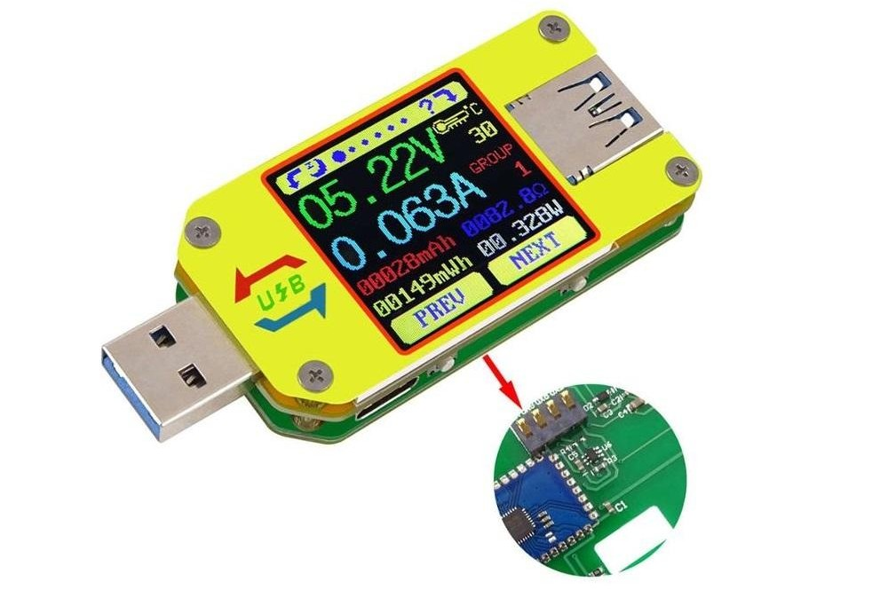

# UM34C BLE Monitor



Tool monitor live untuk **RDTech UM34C varian Bluetooth LE** (service BLE UART `FFE0`/`FFE1`, HM-10 style) di Windows, memakai Python +
[bleak](https://github.com/hbldh/bleak) (BLE via WinRT).

Membaca tegangan, arus, daya, suhu, dan status pengisian secara langsung, serta menyimpan hasil ke CSV. Script monitor hanya mengirim perintah pembacaan `0xF0`.

```
.
+-- README.md            <- dokumentasi ini
+-- um34c_monitor.py     <- program utama (monitor + logging CSV)
+-- um34c_discover.py    <- diagnostik: scan perangkat & lihat peta GATT
```

## Mulai cepat (Windows / PowerShell)

1. Nyalakan UM34C melalui input USB dan aktifkan Bluetooth komputer. Tutup aplikasi HP atau aplikasi vendor yang sedang terhubung ke unit.
2. Periksa Python dan pasang dependensi pada interpreter yang sama:

   ```powershell
   python --version
   python -m pip install bleak==3.0.2
   ```

   Kode memerlukan Python 3.9+ dan Windows 10/11 dengan adapter BLE. Lingkungan pengujian: Python 3.13.12 dan bleak 3.0.2.
3. Untuk unit lain, ubah `ADDR` di **kedua** file Python. Alamat bawaan: `00:15:A3:00:43:9A`.
4. Jalankan diagnostik terlebih dahulu:

   ```powershell
   python um34c_discover.py
   ```

   Hasil yang diharapkan: MAC ditandai `<-- UM34C`, `connected: True`, service `FFE0`, serta characteristic `FFE1` dengan properti `notify` dan `write-without-response`. Scan berjalan selama 10 detik. Nama perangkat kosong (`None`) adalah normal.
5. Uji pembacaan terbatas dan simpan hasilnya:

   ```powershell
   python um34c_monitor.py 100 um34c_test.csv
   ```

   Pengujian berhasil bila ada 100 baris data, tidak ada `timeout` atau `[checksum MISMATCH]`, dan seluruh nilai `chk_ok` adalah `1`. Cocokkan tegangan/arus dengan layar perangkat untuk pemeriksaan manual.

> Jalankan dari folder proyek. Jika memakai terminal agen atau sandbox dan perangkat terlihat saat scan tetapi koneksi gagal, coba terminal PowerShell biasa dengan akses Bluetooth. Pada pengujian proyek ini, koneksi gagal di sandbox tetapi berhasil ketika dijalankan di luar sandbox.

## Hasil pengujian perangkat (7 Oktober 2026)

Pengujian langsung dengan Python 3.13.12 / bleak 3.0.2, menggunakan perintah pada bagian Mulai cepat:

| Pemeriksaan | Hasil |
|---|---|
| Scan BLE | MAC `00:15:A3:00:43:9A`, nama `None`, RSSI -62 dBm |
| Koneksi dan GATT | Berhasil; `FFE1` handle `0x0029`, CCCD `0x002B` |
| Monitor 100 polling | Selesai normal (exit code 0), 100 baris CSV |
| Checksum | 100/100 valid (`chk_ok=1`); tidak ada timeout |
| Waktu data | 05:29:54 sampai 05:30:49, waktu lokal komputer |
| Pembacaan | Tegangan 5.16 V, arus 0 A, daya 0 W, suhu 27 C, mode `DCP1.5A` |

Data tersimpan di [um34c_test.csv](um34c_test.csv). Pengujian memverifikasi komunikasi BLE, parsing, checksum, dan logging. Akurasi terhadap alat ukur referensi, respons saat diberi beban, dan kestabilan jangka panjang belum diuji. Nilai resistansi `9999.9` pada kondisi arus nol tidak membuktikan resistansi kabel.

Koneksi di sandbox awalnya gagal dengan `BleakDeviceNotFoundError` meskipun scan menemukan MAC. Kedua script berhasil setelah dijalankan di luar sandbox, tanpa perubahan kode atau pairing ulang.

## Pemakaian

```
python um34c_monitor.py                 # polling terus-menerus (Ctrl+C untuk stop)
python um34c_monitor.py 100             # 100x polling lalu berhenti
python um34c_monitor.py 100 data.csv    # 100x polling + catat ke CSV
```

Contoh keluaran:

```
Terhubung ke UM34C (00:15:A3:00:43:9A) - polling 0xF0, Ctrl+C untuk stop
V=   5.16V  I=  0.000A  W=   0.000W  T=26C  D+=0.01 D-=0.00  mode=DCP1.5A  mAh=0  mWh=0
```

**Catatan penggunaan:** angka polling menghitung percobaan, termasuk timeout; 100 polling tidak selalu menghasilkan 100 baris CSV. `0` berarti tanpa batas. File CSV dibuka dengan mode `w`, sehingga file dengan nama yang sama akan ditimpa. Gunakan nama baru bila ingin menyimpan hasil sebelumnya.

Kolom CSV: `time, V, I, W, TC, TF, D+, D-, mode, mAh, mWh, ohm, chk_ok`

- `V` tegangan (volt), `I` arus (ampere), `W` daya (watt)
- `TC`/`TF` suhu Celsius/Fahrenheit
- `D+`/`D-` tegangan data USB (volt)
- `mAh`/`mWh` hasil perekaman ambang batas, `ohm` nilai resistansi dari perangkat (bukan hasil pengujian resistansi kabel oleh tool)
- `chk_ok` = 1 jika checksum paket valid (lihat bagian Protokol)

Setting penting di `um34c_monitor.py`:

- `ADDR` - MAC perangkat (default `00:15:A3:00:43:9A`; ganti sesuai unit)
- `POLL_INTERVAL_S` - jeda antar polling (default 0.3 s setelah balasan sukses)
- `CHAR` - characteristic BLE UART (`0000ffe1-...`)
- `RESPONSE_TIMEOUT_S` - batas tunggu satu paket lengkap (default 2 detik)

---

## Catatan sigrok-cli pada setup sebelumnya

Catatan berikut berasal dari investigasi setup sebelumnya, bukan pengujian ulang sigrok-cli pada sesi ini:

1. **libsigrok hanya mendukung Bluetooth lewat BlueZ (Linux).**
   Transport `conn=bt/...` diimplementasikan di `src/serial_bt.c` dengan backend `src/bt/bt_bluez.c`. Tidak ada backend Bluetooth untuk Windows.
2. **Build Windows sigrok-cli tidak dikompilasi dengan dukungan Bluetooth.**
   Binari tidak mengandung string `serial-bt`, `bt/rfcomm`, `bt/dialog`, dst. Akibatnya `conn=bt/...` diperlakukan sebagai **nama port serial biasa** dan
   error yang muncul selalu dari lapisan `serial-libsp` ("cannot find the path/file specified"), bukan dari lapisan `serial-bt`.
3. **Unit yang diuji adalah varian BLE, bukan Bluetooth SPP klasik seperti pada
   dokumentasi wiki.** Windows mem-pair perangkat sebagai `BTHLE` (Bluetooth Low Energy), bukan `BTHENUM` (SPP). Konsekuensinya **tidak ada COM port**  yang dibuat, sehingga jalur "pairing -> COM port -> `conn=COMx`" (yang biasa dipakai untuk UM24C/25C versi SPP) juga tidak tersedia.

Jadi di Windows, `sigrok-cli` tidak dapat berkomunikasi dengan varian BLE ini. Jalur BLE hanya didukung oleh libsigrok yang dibuild dengan BlueZ (Linux):

```
# di Linux/Raspberry Pi, libsigrok yang ada dukungan Bluetooth (HAVE_BLUETOOTH)
sigrok-cli -d rdtech-um:conn=bt/notify/00-15-a3-00-43-9a/handle_rx=41/handle_cccd=43 --scan
```

(`handle_rx`/`handle_cccd` berasal dari peta GATT di bawah; tipe `notify` adalah transport BLE generik yang bisa diarahkan ke handle manual.)

### Catatan pairing (Windows)

- Script **tidak memerlukan pairing**; script melakukan scan lalu connect langsung (BLE "Just Works").
- Jika terjadi **"phantom connected"** (Windows menganggap device masih `Connected` padahal link sudah mati), device berhenti advertise dan GATT
  tidak bisa diakses ("Unreachable"). Solusi: **unpair** device di Settings > Bluetooth & devices, tunggu LED berkedip, lalu jalankan script.
- Pairing tetap dimungkinkan bila ingin memakai aplikasi vendor, tetapi tidak diperlukan oleh tool ini.

### Peta GATT device (hasil observasi)

```
Service 00001800 - Generic Access       (nama device, appearance, dst)
Service 00001801 - Generic Attribute
Service 00001804 - Tx Power
Service 0000180F - Battery
Service 0000180A - Device Information
Service 0000FFE0 - BLE UART (HM-10 style)   <-- jalur data UM34C
  CHAR 0000FFE1  props=write,write-without-response,notify  handle=0x0029
    DESC 00002902 (CCCD)                                    handle=0x002B
  CHAR 0000FFE2  props=write,write-without-response         handle=0x002C
```

- Advertising: **tanpa nama** (`local_name` kosong), service UUID `FFE0`. Manufacturer data company ID `0x050E`, isinya MAC device little-endian
  (`9a4300a31500` = `00:15:a3:00:43:9a`). Karena itu script mencocokkan device berdasarkan **MAC**, bukan nama.
- MAC perangkat yang diuji: `00:15:A3:00:43:9A`.

---

## Cara kerja komunikasi

Protokol datanya **sama** dengan dokumentasi sigrok wiki (UM24C/25C/34C); yang berbeda hanya **transport-nya**:

| | Wiki sigrok | Device ini |
|---|---|---|
| Transport | Serial-over-Bluetooth SPP (RFCOMM), 9600 8N1 | BLE GATT: service `FFE0`, char `FFE1` (HM-10 style) |
| Jalur di host | `conn=bt/rfcomm/<MAC>` atau `/dev/rfcomm0` | write/notify di `FFE1` |
| Enkapsulasi | byte stream serial | byte stream NUS/HM-10 (transparan, tanpa framing tambahan) |
| Protokol aplikasi | **0xF0 -> dump 130 byte** | **identik** |

Alur di `um34c_monitor.py`:

1. Monitor membuat `BleakClient` dari `ADDR`; bleak menangani penemuan alamat saat koneksi. Script diagnostik melakukan scan eksplisit selama 10 detik.
2. Connect (bleak/WinRT), lalu `start_notify` pada characteristic `FFE1` (subscribe ke CCCD `0x002B`).
3. Kirim byte perintah `0xF0` ke `FFE1` (write without response).
4. Device membalas dump status 130 byte lewat notification di `FFE1`. BLE memecahnya menjadi beberapa notification kecil; script mengakumulasi
   byte sampai menemukan paket lengkap yang diawali model ID `0x0d 0x4c` (UM34C), lalu mem-parse sesuai tabel offset di bawah.
5. Setelah balasan sukses, tunggu `POLL_INTERVAL_S` sebelum polling berikutnya. Waktu balasan menambah durasi siklus, sehingga 0.3 detik bukan jaminan frekuensi tepat 3 Hz. Saat timeout, kode langsung mencoba polling berikutnya.

Secara protokol, perangkat UM series itu _polling-based_: tidak streaming otomatis (kecuali satu byte `0xff` ~500 ms setelah power-on). Host harus
mengirim `0xF0` untuk meminta data.

### Perintah (byte yang dikirim ke device)

| Byte | Jenis | Arti |
|---|---|---|
| `0xF0` | control | Minta data dump (memicu balasan 130 byte) |
| `0xF1` | control | Pindah ke layar berikutnya |
| `0xF2` | control | Putar layar |
| `0xF3` | control | UM25C/UM34C: layar sebelumnya; UM24C: grup data berikutnya |
| `0xF4` | control | Hapus grup data |
| `0xA0`–`0xA9` | control | Pilih grup data 0–9 (UM25C/UM34C) |
| `0xB0`–`0xCE` | config | Set ambang perekaman 0.00–0.30 A (nilai desimal ditambah ke `0xB0`) |
| `0xD0`–`0xD5` | config | Set backlight 0–5 |
| `0xE0`–`0xE9` | config | Set screen timeout 0–9 menit (0 = nonaktif) |

Script ini sengaja hanya mengirim `0xF0` (mode monitor, read-only). Perintah lain bisa ditambahkan bila perlu.

### Format balasan (dump 130 byte, big-endian, unsigned)

Semua offset desimal, inklusif. "centivolt" = 1/100 V, "deci-ohm" = 0.1 Ω.

| Offset | Len | Jenis | Arti |
|---|---|---|---|
| 0 | 2 | model | Model ID: `0x0963`=UM24C, `0x09c9`=UM25C, `0x0d4c`=UM34C |
| 2 | 2 | ukur | Tegangan — UM25C: milivolt; UM24C/UM34C: centivolt |
| 4 | 2 | ukur | Arus — UM25C: 1/10000 A; UM24C/UM34C: miliampere |
| 6 | 4 | ukur | Daya (milivolt-ampere = mW) |
| 10 | 2 | ukur | Suhu Celsius |
| 12 | 2 | ukur | Suhu Fahrenheit |
| 14 | 2 | config | Grup data terpilih (0-based) |
| 16 | 80 | ukur | 10 grup kapasitas: tiap grup 4 byte mAh + 4 byte mWh |
| 96 | 2 | ukur | Tegangan data line D+ (centivolt) |
| 98 | 2 | ukur | Tegangan data line D- (centivolt) |
| 100 | 2 | ukur | Index mode pengisian (tabel di bawah) |
| 102 | 4 | ukur | mAh dari perekaman ambang batas |
| 106 | 4 | ukur | mWh dari perekaman ambang batas |
| 110 | 2 | config | Ambang perekaman terkonfigurasi (centiampere) |
| 112 | 4 | ukur | Durasi perekaman ambang batas (detik kumulatif) |
| 116 | 2 | config | Perekaman ambang batas aktif (1/0) |
| 118 | 2 | config | Setting screen timeout (menit) |
| 120 | 2 | config | Setting backlight (0–5) |
| 122 | 4 | ukur | Resistansi (deci-ohm) |
| 126 | 2 | config | Layar aktif saat ini (0-based) |
| 128 | 1 | ? | Tidak diketahui (diduga stop marker) |
| 129 | 1 | checksum | Checksum UM34C (lihat bawah) |

`parse()` hanya mengekstrak kolom yang ditampilkan atau dicatat ke CSV. Grup data, durasi, dan pengaturan pada tabel belum diekspor oleh script.

### Mode pengisian (offset 100)

| Index | Display | Arti |
|---|---|---|
| 0 | UNKNOWN | Normal / mode non-custom |
| 1 | QC2 | Qualcomm Quick Charge 2.0 |
| 2 | QC3 | Qualcomm Quick Charge 3.0 |
| 3 | APP2.4A | Apple, maks 2.4 A |
| 4 | APP2.1A | Apple, maks 2.1 A |
| 5 | APP1.0A | Apple, maks 1.0 A |
| 6 | APP0.5A | Apple, maks 0.5 A |
| 7 | DCP1.5A | Dedicated Charging Port, maks 1.5 A |
| 8 | SAMSUNG | Samsung (Adaptive Fast Charging?) |

### Checksum (khusus UM34C, byte ke-129)

XOR dari byte-byte di posisi ganjil tertentu (bukan semua byte):

```python
def checksum(pkt):
    positions = [
        1, 3, 7, 9, 15, 17, 19, 23, 31, 39, 41, 45, 49, 53, 55, 57, 59, 63,
        67, 69, 73, 79, 83, 89, 97, 99, 109, 111, 113, 119, 121, 127,
    ]
    csum = 0
    for pos in positions:
        csum ^= pkt[pos]
    return csum
```

`um34c_monitor.py` memvalidasi ini setiap paket (`chk_ok`).

---

## Troubleshooting

| Gejala | Penyebab / solusi |
|---|---|
| Script: "UM34C tidak ditemukan" / scan tidak melihat MAC-nya | Device berhenti advertise. Biasanya karena "phantom connected" di Windows atau masih terhubung ke app di HP. Unpair device di Settings, matikan Bluetooth HP / app RDTech, atau cabut-colok power UM34C (LED harus berkedip). |
| Scan jalan tapi connect "Unreachable" | Sama seperti di atas (link basi). Unpair lalu coba lagi. |
| `BleakDeviceNotFoundError` setelah MAC terlihat saat scan | Periksa akses Bluetooth terminal/sandbox; coba PowerShell biasa. Jika tetap gagal, tutup koneksi host lain dan cabut-colok daya perangkat. |
| Nama device kosong saat scan | Wajar. Device ini tidak meng-advertise nama; cocokkan lewat MAC. |
| `timeout, N byte diterima: ...` | Paket tidak lengkap. Ulangi; jauhkan sumber interferensi; pastikan tidak ada host lain yang connect. |
| `[checksum MISMATCH]` | Byte checksum tidak cocok dengan rumus; integritas data tidak terverifikasi. Script tetap mencatat baris dengan `chk_ok=0`; ulangi uji dan periksa koneksi. |

## Referensi

- Protokol UM series (sumber utama tabel di atas): <https://sigrok.org/wiki/RDTech_UM_series> (didokumentasikan oleh Sven Slootweg, driver sigrok oleh Andreas Sandberg & Gerhard Sittig)
- bleak (Python BLE library): <https://github.com/hbldh/bleak>
- rdumtool (tool Python lain untuk UM seri, jalur RFCOMM): <https://github.com/rfinnie/rdumtool>
- Implementasi transport BT/BLE libsigrok (BlueZ): `libsigrok/src/serial_bt.c`, `libsigrok/src/bt/bt_bluez.c`
